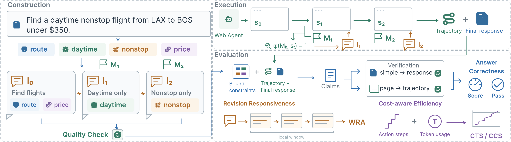

# 🌐 DynaRev: Benchmarking Web Agents under Dynamic Goal Revision

[📄 Paper](https://arxiv.org/abs/2610.40133)

DynaRev evaluates how web agents adapt to changing user goals. It contains **181 tasks** covering additive revisions, unconditional overrides, and conditional overrides, delivered at semantic milestones during execution. The runner uses [BrowserGym](https://github.com/ServiceNow/BrowserGym), with trajectory-grounded evaluation of correctness, responsiveness, and efficiency.



## 📊 Data

Tasks are constructed from [Online-Mind2Web](https://huggingface.co/datasets/osunlp/Online-Mind2Web) and [Mind2Web 2](https://huggingface.co/datasets/osunlp/Mind2Web-2).

| File | Tasks |
| --- | ---: |
| [data/additive.jsonl](data/additive.jsonl) | 76 |
| [data/unconditional_override.jsonl](data/unconditional_override.jsonl) | 62 |
| [data/conditional_override.jsonl](data/conditional_override.jsonl) | 43 |

Each JSONL line defines the initial instruction, revisions, milestones, evaluation constraints, and runtime settings. The default task budget is 100 steps.

## ⚙️ Setup

Use **Python 3.12**. Run commands from the repository root.

```bash
conda create -n dynarev python=3.12 -y
conda activate dynarev
python -m pip install -r requirements.txt
python -m playwright install --with-deps chromium
```

Installing browser system dependencies may require administrator privileges.

Configure an OpenAI-compatible endpoint and replace the placeholders:

```bash
export OPENAI_BASE_URL="https://your-api-endpoint.example/v1"
export OPENAI_API_KEY="your-api-key"
```

Replace `MODEL_NAME` below with the model identifier accepted by your endpoint. For provider-specific model prefixes, use the environment variables defined in [src/utils/client.py](src/utils/client.py).

## 🚀 Run

Run one additive task:

```bash
python -m src.dyna_agent \
  --dataset-path data/additive.jsonl \
  --policy-model MODEL_NAME \
  --mode baseline --max-steps 100 --limit 1 \
  --headless --viewport-only --exec-workers 1 \
  --run-name demo_additive
```

Use `--limit 0` for the full file, and change `--dataset-path` for other revision types. Use a new --run-name for each experiment.

## 📏 Evaluate

Score correctness, then revision-level satisfaction and responsiveness:

```bash
python -m src.evaluate_logs \
  --run-dir logs/runs/demo_additive \
  --dataset-path data/additive.jsonl \
  --evaluator-model MODEL_NAME --eval-workers 1

python -m src.evaluate_response \
  --run-dir logs/runs/demo_additive \
  --dataset-path data/additive.jsonl \
  --judge-model MODEL_NAME
```

Results are saved under `logs/runs/demo_additive/evaluations/`. Add `--force` to recompute existing evaluations.

For additional runner options, use `python -m src.dyna_agent --help`. Task construction options are available through `python -m src.dyna_pipeline --help`.

## 📖 Citation

If you use DynaRev in your research, please cite:

```bibtex
@misc{zhang2026dynarevbenchmarkingwebagents,
      title={DynaRev: Benchmarking Web Agents under Dynamic Goal Revision},
      author={Shiqi Zhang and Guochen Zhou and Zesheng Wei and Hai Zhao and Zhisong Zhang},
      year={2026},
      eprint={2610.40133},
      archivePrefix={arXiv},
      primaryClass={cs.AI},
      url={https://arxiv.org/abs/2610.40133},
}
```
